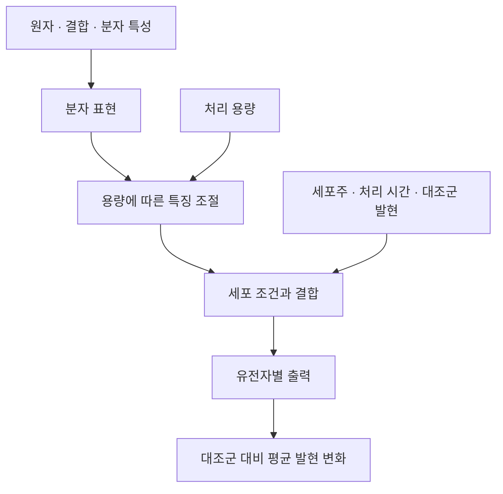

[포트폴리오](../../README.md) / [Mol2Expr](README.md) / 모델과 코드

# Mol2Expr · 모델과 코드

[프로젝트 소개](README.md) &nbsp; · &nbsp; **모델과 코드 설명** &nbsp; · &nbsp; [핵심 코드](model_sketch.py)

초기 분자 지문 모델 이후 살펴본 **그래프 기반 후보 구성**을 설명합니다. 분자 구조와 세포 조건을 함께 사용해 발현 변화를 예측하려는 흐름이며, 이 구성의 예측 성능은 아직 검토 중입니다.

## 전체 흐름

모델에서 구분하는 세 요소는 **약물 처리(P)**, **실험 조건(C)**, **예측할 유전자(R)**입니다. LPM의 구분 방식을 참고하되, 이 프로젝트에서는 화합물의 분자 구조를 입력하는 데 관심을 두었습니다.

## 각 부분을 구성한 생각

**1. 분자 구조에서 공통점 찾기** 
앞선 실험에서는 Morgan 분자 지문을 사용했습니다. 이후 구성에서는 원자를 노드, 결합을 연결로 표현하고 이웃 원자의 정보를 모아 분자 특징을 만들려 했습니다. 분자량 등 물리화학적 특성도 함께 사용합니다.

**2. 용량과 세포 조건 반영하기** 
같은 약물도 처리 용량과 세포 상태에 따라 반응이 달라질 수 있어, 용량에 따라 분자 특징의 크기를 조절하고 세포 조건으로 특징을 다시 조절하는 구성을 시도했습니다. 코드의 용량 조절값은 모델이 학습하는 값이며, 실험에서 측정한 IC50이나 EC50을 의미하지는 않습니다.

**3. 유전자별 발현 변화로 바꾸기** 
조건별 평균 반응을 기준으로 약물별 차이를 학습하고, 출력을 대조군 대비 발현 변화의 척도로 되돌리는 구성입니다. 예측 대상은 같은 조건의 세포들을 모아 얻은 평균 발현 차이입니다.

## 공개 코드와 연결해서 읽기

[`model_sketch.py`](model_sketch.py)는 아래 계산을 발췌한 예시입니다.

| 코드 | 하는 일 |
| --- | --- |
| `GraphMessageLayer` | 결합 종류별로 이웃 원자의 정보를 모아 원자 특징 갱신 |
| `dose_gate` | 정규화된 용량에 따라 분자 특징의 크기 조절 |
| `condition_perturbation` | 세포 조건으로 특징의 크기와 값을 조절하는 FiLM 형태의 계산 |
| `factorized_readout` | 잠재 계수와 유전자 표현을 이용해 유전자별 출력 생성 |
| `restore_response` | 기준 반응과 표준화에 사용한 평균·척도를 반영해 발현 변화로 복원 |

원자 특징을 분자 전체의 표현으로 모으는 부분, 데이터 전처리와 처리군·대조군 평균 계산, 전체 학습 및 평가 코드는 이 예시에 포함하지 않았습니다. 코드는 각 계산을 읽어 보는 용도이며, 독립적으로 학습을 실행하는 완성된 모델은 아닙니다.

## 참고한 자료와 연결 지점

| 자료 | 참고한 내용 |
| --- | --- |
| [LPM](https://www.nature.com/articles/s43588-025-00870-1) | 처리·예측 대상·실험 조건을 구분하는 관점과, 학습에 없는 새로운 처리의 표현 문제 |
| [chemCPA](https://proceedings.neurips.cc/paper_files/paper/2022/hash/aa933b5abc1be30baece1d230ec575a7-Abstract-Conference.html) | 분자 표현을 이용해 보지 못한 약물의 반응을 예측하는 접근 |
| [Neural Message Passing for Quantum Chemistry](https://proceedings.mlr.press/v70/gilmer17a.html) | 연결된 원자 사이의 정보 교환을 통한 분자 표현 |
| [FiLM](https://arxiv.org/abs/1709.07871) | 조건에 따라 내부 특징의 크기와 값을 조절하는 방법 |
| [RDKit 문서](https://rdkit.org/docs/GettingStartedInPython.html#morgan-fingerprints-circular-fingerprints) | Morgan 분자 지문과 분자 특성 계산 |
| [SciPlex](https://pubmed.ncbi.nlm.nih.gov/31806696/) | 약물 처리에 따른 발현 데이터를 살펴보기 위한 자료 |

LPM은 화합물뿐 아니라 유전자 조작 등 다양한 처리를 다룹니다. 위 자료에서는 각 구성의 아이디어를 참고했으며, 원 논문의 전체 모델을 재현한 작업은 아닙니다.

---

[← 프로젝트 소개](README.md) &nbsp; · &nbsp; [핵심 코드 →](model_sketch.py)
