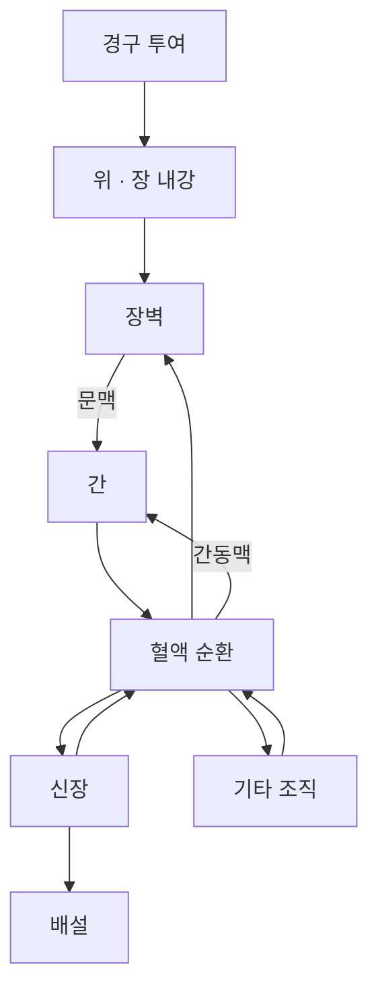

[포트폴리오](../../README.md) / [TissuePK](README.md) / 모델과 코드

# TissuePK · 모델과 코드

[프로젝트 소개](README.md) &nbsp; · &nbsp; **모델과 코드 설명** &nbsp; · &nbsp; [핵심 코드](model_sketch.py)

약물이 몸에 들어온 뒤 조직 사이를 이동하고 제거되는 과정을 구획으로 나누어 계산했습니다. 각 구획의 약물량을 시간에 따라 계산하고, 부피를 이용해 농도로 바꾸는 구성입니다.

## 조직을 연결하는 방식

그림은 주요 이동 경로를 요약한 것입니다. 실제로 살펴본 구성에서는 위장관과 간을 여러 구간으로 나누었습니다.

## 각 구획에서 계산한 내용

**1. 장 — 흡수와 다음 구간으로의 이동** 
위에서 장으로 이동한 약물이 장벽으로 흡수되거나 다음 장 구간으로 넘어가는 과정을 계산합니다. `absorption_scale`은 흡수 속도를 조절하는 값이며, 최종적으로 흡수되는 비율 자체를 뜻하지는 않습니다.

**2. 혈류 — 조직 사이의 이동** 
각 구획의 약물량·부피·분배계수와 들어오고 나가는 혈류를 사용합니다. 구획 내부에서는 약물이 균일하게 섞여 있다고 단순화하며, 코드에서는 조직 농도를 분배계수로 나눈 혈액 환산 농도를 이동 계산에 사용합니다.

**3. 간과 신장 — 대사와 제거** 
간에서는 농도가 높아지면 대사 속도가 한계에 가까워지는 Michaelis–Menten 형태를 사용했습니다. 신장에서는 겉보기 청소율을 이용해 제거 속도를 계산했습니다. 이때 필요한 매개변수의 의미와 출처를 함께 검토하고 있습니다.

## 공개 코드와 연결해서 읽기

[`model_sketch.py`](model_sketch.py)는 아래 계산을 발췌한 예시입니다.

| 코드 | 하는 일 |
| --- | --- |
| `equivalent_concentration` | 약물량·부피·분배계수로 혈액 환산 농도 계산 |
| `michaelis_menten` | 비결합 약물 농도에 따른 대사 속도 계산 |
| `intestinal_segment` | 한 장 구간의 흡수·이동·장벽 대사를 반영한 약물량 변화율 계산 |
| `liver_zones` | 직렬로 연결한 세 간 구간의 혈류와 대사 계산 |
| `kidney_compartment` | 신장으로의 이동과 제거를 반영한 약물량 변화율 계산 |

시간은 `h`, 약물량은 `mg`, 부피는 `L`을 기준으로 합니다. 구획 함수가 반환하는 것은 시간당 약물량의 변화율이며, 이 값들을 적분해야 시간에 따른 농도 곡선을 얻을 수 있습니다.

전체 구획을 연결하는 적분 코드, 약물별 매개변수, 에날라프릴에서 대사체가 생성되는 전체 과정은 이 예시에 포함하지 않았습니다. 따라서 이 파일만으로 공개 자료와 비교한 농도 곡선을 재현할 수는 없습니다.

## 참고한 자료와 연결 지점

| 자료 | 참고한 내용 |
| --- | --- |
| [Claassen 등의 에날라프릴 PBPK·PD 모델](https://www.frontiersin.org/journals/physiology/articles/10.3389/fphys.2013.00004/full) | 체내 이동·대사와 호르몬 반응을 연결한 연구. 구획 연결과 대사·배설 매개변수의 배경 참고 |
| [Open Systems Pharmacology 문서](https://docs.open-systems-pharmacology.org/working-with-pk-sim/pk-sim-documentation/pk-sim-compounds-defining-inhibition-induction-processes) | 대사 속도에 영향을 주는 변수와 효소 억제·유도 과정의 설명 |
| [PK-DB](https://academic.oup.com/nar/article/49/D1/D1358/5957165) | 모델과 비교할 투여 조건 및 시간별 관측 농도 |

참고 논문은 약동학과 약력학을 함께 다루지만, 제가 우선 시도한 범위는 약동학 계산입니다. 각 구획의 계산을 이해하고 관측값과의 차이를 설명하는 데 집중하고 있습니다.

---

[← 프로젝트 소개](README.md) &nbsp; · &nbsp; [핵심 코드 →](model_sketch.py)
